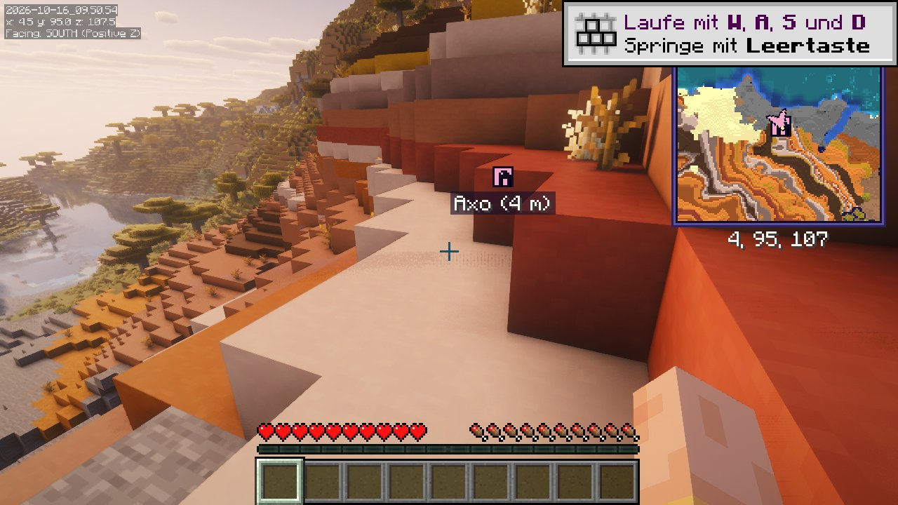
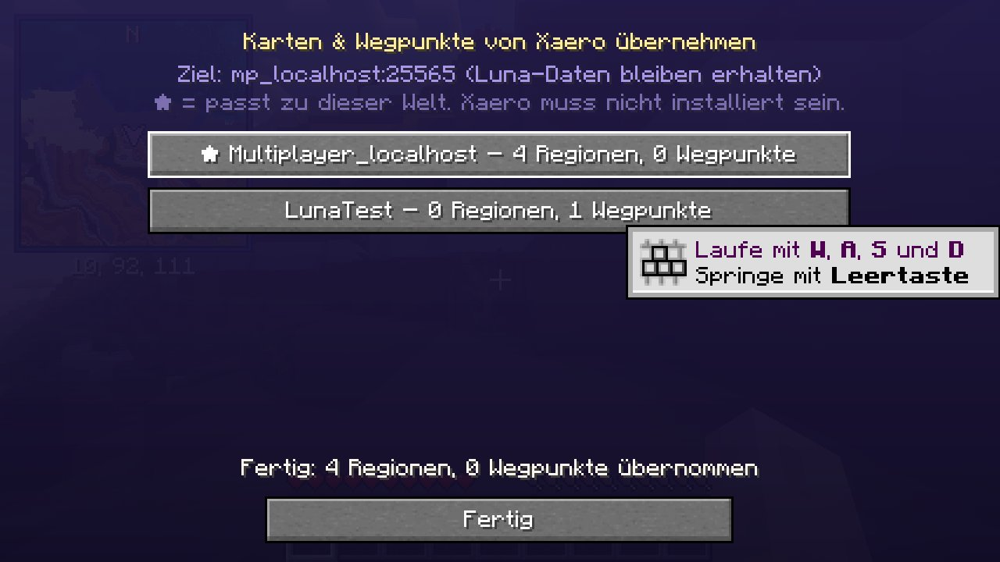
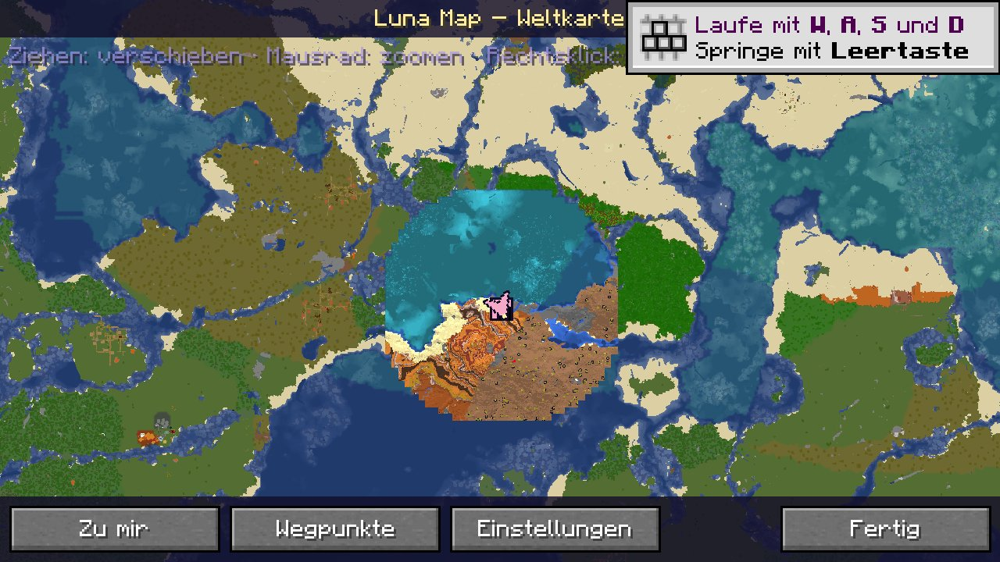

# 🌙 Luna Map

Eigene Minimap + Weltkarte + Wegpunkte für **Fabric, Minecraft 26.3** – im Luna-Look mit **Axo** 🩷.
Läuft **allein**, ohne Xaero (und ohne sonstige Karten-Mods).



## Was kann's?

| | |
|---|---|
| **Minimap** | Norden oben, Pfeil dreht sich mit, Koordinaten; per **Drag & Drop** verschieben und in der Größe ändern (Einstellungen → *Minimap verschieben…*) |
| **Höhlen** | unter der Erde schaltet die Karte automatisch auf die Höhlenansicht um (pro 16er-Höhenband gespeichert) |
| **Radar** (`Tab`) | Mit `Tab` an/aus. Minimap und Weltkarte: Mobs als **Kopf** (gelber Rahmen = feindlich, grüner = friedlich; Mobs ohne Kopf als Punkt), Items = rote Raute, andere Spieler = ihr Skin-Kopf (auf der Weltkarte mit Name); weit über/unter dir = blasser |
| **Weltkarte** (`J`) | ziehen = verschieben, Mausrad = zoomen, Rechtsklick = Wegpunkt; merkt sich alles, was du erkundet hast (pro Welt/Server und Dimension) |
| **Wegpunkte** (`B`) | Name, Farbe (Palette oder eigener Hex-Wert wie `#FF66AA`), Koordinaten; in der Welt, auf Minimap und Weltkarte. In der Welt als kleines Schild mit den ersten zwei Buchstaben – Name und Entfernung erscheinen, wenn du draufschaust. In der Liste mit ●/○ einzeln ausblenden |
| **3D-Ansicht** | Weltkarte: Knopf **3D/2D** oder Mausrad gedrückt halten und ziehen (seitlich = drehen, hoch/runter = neigen). Zeigt Berge, Bäume und Täler mit echter Höhe (aus eigenem Scan und BlueMap); wird nur neu gerechnet, wenn sich etwas ändert |
| **Todespunkte** | Beim Tod erscheint „Tod“ mit Totenkopf (Minimap, Weltkarte, in der Welt). Erreichst du ihn, verschwindet er. Stirbst du vorher nochmal, wird der alte zu „Vorheriger Tod“ (grauer Totenkopf). In den Einstellungen abschaltbar |
| **Wegpunkte teilen** | Wegpunktliste → *Teilen* schickt ihn in den Chat – im Format von Xaero's Minimap, also können Xaero-Spieler ihn übernehmen. Geteilte Wegpunkte von Xaero- oder Luna-Spielern erscheinen als Chatzeile: anklicken = speichern |
| **Xaero-Import** | übernimmt Karten **und** Wegpunkte aus `.minecraft/xaero` – du musst nicht neu erkunden |
| **BlueMap** | Link des Servers einfügen → Luna Map lädt die aktuelle Karte vom Server (gilt nur für diesen Server) |
| **Shader** | getestet mit Iris + Complementary Reimagined / MakeUp; alles wird als HUD gezeichnet, keine Mixins |
| **Auto-Update** | prüft beim Start die [Releases](https://github.com/Luna-OS/luna-map-mod/releases), lädt eine neuere Version herunter und tauscht sie beim Beenden von Minecraft aus (abschaltbar) |

`N` schaltet die Minimap an/aus, `Tab` das Radar (Mobs, Items, Spieler). Alle Tasten lassen sich unter *Optionen → Steuerung → Luna Map* ändern.

## Installation

1. [`dist/luna-map-2.1.2+26.3.jar`](dist/luna-map-2.1.2+26.3.jar) (oder aus den [Releases](https://github.com/Luna-OS/luna-map-mod/releases)) in den `mods`-Ordner.
2. Braucht nur **Fabric API**. **Mod Menu** ist optional (Einstellungen auch über die Weltkarte → *Einstellungen*).
3. **Xaero's Minimap und Xaero's World Map rauswerfen** (und die alte `luna-map-1.0.0+26.3.jar`) – sonst gibt es
   doppelte Karten und doppelte Tasten. Deine Xaero-Daten bleiben im Ordner `xaero` liegen und können importiert werden.

## Xaero-Karten übernehmen

Auf dem Server (z. B. ZweersSMP) einloggen → `J` → *Einstellungen* → **Xaero-Daten holen** → den Eintrag mit ★ anklicken.



- Liest Xaeros Server-Karten (`xaero/world-map/Multiplayer_…/…/mw$default/*.zip`, Format bis Xaero's World Map 1.47)
  und die Wegpunkte (`xaero/minimap/…/dim%…/*.txt`), alle Dimensionen.
- Läuft im Hintergrund, schon erkundete Luna-Daten werden nicht überschrieben, doppelte Wegpunkte übersprungen.
- Im Einzelspieler speichert Xaero keine eigenen Kartendateien – dort gibt es nur die Wegpunkte zu übernehmen.

## BlueMap (immer aktuelle Karte)

Hat der Server eine [BlueMap](https://bluemap.bluecolored.de/), dann: `J` → *Einstellungen* → **Online-Karte (BlueMap)** →
Link aus dem Browser einfügen (z. B. `https://map.server.de/#world:…`) → *Verbinden* – fertig. Alle Dimensionen werden
automatisch zugeordnet, nichts auswählen.



- Der Link wird **nur für diesen Server/diese Welt** gespeichert (`lunamap/<server>/bluemap.json`), pro Dimension eine Karte.
- **Automatische Dimensionen:** zuerst nach Namen (Nether, End …), dann sicher über BlueMaps Live-Daten: Luna Map schaut,
  auf welcher Karte dein Spieler gerade steht (✔ im Menü). Neue Dimensionen (auch aus Mods) werden beim Betreten zugeordnet.
- **Ganze Karte:** Zoomst du auf der Weltkarte heraus, zeigt Luna Map die komplette BlueMap (BlueMaps grobe
  Stufen mit 5 bzw. 25 Blöcken pro Pixel) – so weit, wie die Karte auf dem Server reicht.
- **Nah dran / Minimap:** blockgenaue Kacheln um dich herum und im sichtbaren Ausschnitt; die Weltkarte zoomt bis
  32 Pixel pro Block, die Minimap hat zusätzlich „Sehr nah“.
- **Detailansicht:** Ab 3 Pixeln pro Block zeichnet Luna Map BlueMaps hochaufgelöste 3D-Kacheln von oben – mit echten
  Block-Texturen (16 Pixel pro Block, Wasser durchsichtig, Schatten unter Überhängen). Auch in der Minimap bei „Sehr nah“.
- **Immer aktuell:** alle 2 Minuten (Übersicht alle 5 Minuten) wird nachgesehen, ob BlueMap neu gerendert hat –
  geänderte Kacheln werden automatisch übernommen, unveränderte nicht nochmal verarbeitet.
  Wo du gerade bist (geladene Chunks), zählt immer der eigene Live-Scan.
- **Offline:** geladene Kacheln landen in `lunamap/<server>/bluemap/` und werden genutzt, wenn die BlueMap mal nicht erreichbar ist.
- Es werden nur Dateien gelesen (`settings.json`, `tiles/…png`, `tiles/0/…prbm`, `textures.json`, `live/players.json`), es wird nichts an den Server geschickt.

## Zusammen mit deinen anderen Mods

Getestet zusammen mit: Sodium, Iris (+ Shader), Distant Horizons, Litematica + MaLiLib, MiniHUD, Jade, Lithium,
Sodium Extra, ImmediatelyFast, Entity Culling.

- Weltkarte liegt auf **J**, weil **Litematica** standardmäßig **M** benutzt.
- Minimap steht **oben rechts**, weil **MiniHUD** seine Infozeilen oben links zeichnet. Sind Effekte aktiv, rutscht sie darunter.
- Distant Horizons meldet mit Shader-Schatten Fehler im Log (`Close the existing render pass…`) – die kommen von DH/Iris, nicht von Luna Map.

## Selbst bauen

```bash
./build.sh                       # braucht JDK 25, python3, zip, curl
python3 tools/make_assets.py     # Icon, Axo-Logo und Pfeil neu erzeugen
```

| Ordner | Inhalt |
|---|---|
| `src/main/java/luna/map/data/` | Chunk-Scanner, Kartenspeicher (256×256-Regionen, `lunamap/…/*.lmap`), Wegpunkte |
| `src/main/java/luna/map/ui/` | Minimap, Weltkarte, Wegpunkt-Screens, Einstellungen |
| `src/main/java/luna/map/importer/` | Leser für Xaeros Karten- und Wegpunkt-Dateien |
| `src/main/java/luna/map/online/` | BlueMap-Anbindung |

## Lizenz

MIT – siehe [LICENSE](LICENSE). Luna Map enthält keinen Code von Xaero oder BlueMap; der Import liest nur deren Dateien.
