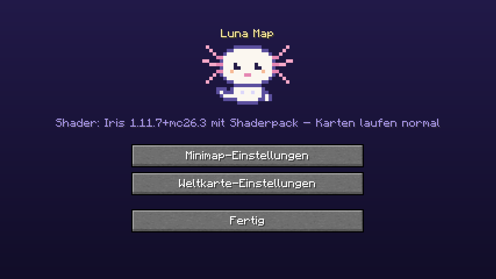
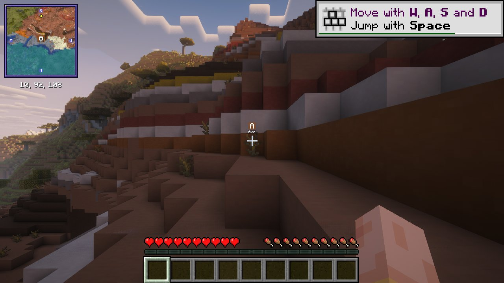

# 🌙 Luna Map

Luna-Look für **Xaero's Minimap** und **Xaero's World Map** (Fabric, Minecraft 26.3):

- **Axo** als Mod-Logo 🩷
- **Luna-Theme**: Minimap-Rahmen in Nachtlila/Lavendel, als eingebautes Ressourcenpaket
  („Luna Map Theme“, standardmäßig an, abschaltbar unter *Optionen → Ressourcenpakete*)
- **Ein gemeinsamer Screen** für beide Karten (Mod Menu → Luna Map → ⚙️):
  Minimap-Einstellungen, Weltkarte-Einstellungen und Shader-Status auf einen Blick
- **Kein Patreon-Banner**: Luna Map stellt in XaeroLib „Internetzugriff erlauben“ auf *aus*
  (`config/xaero/lib/common.cfg` → `allow_internet_access = false`). Dadurch lädt Xaero keine
  Online-Widgets mehr („Give $1/month …“ in den Einstellungen). Nebenwirkung: Xaero sucht dann
  auch nicht mehr online nach Updates und lädt keine Patreon-Namen bzw. -Capes.
- **Iris/Shaderpacks**: geprüft, siehe unten



## Download & Installation

👉 [`dist/luna-map-1.0.0+26.3.jar`](dist/luna-map-1.0.0+26.3.jar) in den `mods`-Ordner legen, **zusammen mit**:

| Mod | Version |
|---|---|
| [Xaero's Minimap](https://modrinth.com/mod/xaeros-minimap) | 26.6.0 oder neuer |
| [Xaero's World Map](https://modrinth.com/mod/xaeros-world-map) | 1.47.0 oder neuer |
| Fabric API | 0.163.0+26.3 |
| Mod Menu (optional, für den Luna-Screen) | 21.0.0 |

> ℹ️ Warum nicht alles in einem Jar? Xaero's Minimap und World Map stehen unter
> **„All Rights Reserved“** – deren Code darf nicht verändert und neu verteilt werden.
> Luna Map enthält deshalb keinen Xaero-Code, sondern legt sich als eigener Mod darüber.
> Die Xaero-Jars lädst du wie gewohnt selbst herunter.

## Iris & Shaderpacks

Getestet mit Fabric Loader 0.20.0, Sodium 0.9.3-beta.1, **Iris 1.11.7** und den Shaderpacks
**Complementary Reimagined r5.9.3** und **MakeUp Ultra Fast 9.5g**:

- Minimap, Wegpunkte in der Welt und Weltkarte werden mit Shader korrekt angezeigt
- keine Fehler oder Mixin-Konflikte im Log



Warum das passt: Xaero zeichnet Minimap, Weltkarte und auch die Wegpunkte in der Welt im
HUD bzw. in eigene Framebuffer, nicht in die Welt-Passes von Iris. Iris ersetzt Shader nur
beim Welt-Rendering in den Haupt-Framebuffer, und die Wegpunkt-Projektion von Xaero nutzt
nur X/Y, deshalb stört auch Iris' Reverse-Z-Umstellung nicht. Luna Map selbst hat **keine Mixins**
und rendert nur in seinem eigenen Menü, kann Shader also nicht beeinflussen.

Getestet wurde wirklich im Spiel (headless mit Mesa/llvmpipe): Welt laden, Minimap, Wegpunkt
„Axo“ in der Welt, Weltkarte (M), Luna-Screen und beide Xaero-Einstellungsseiten.

## Selbst bauen

```bash
./build.sh                         # braucht JDK 25, python3, zip, curl
python3 tools/make_assets.py <pfad/zu/xaerominimap-fabric-26.3-26.6.0.jar>   # Grafiken neu erzeugen
```

`build.sh` lädt die Abhängigkeiten nach `.deps/` (Minecraft 26.3, Fabric Loader, Fabric API,
Mod Menu, Iris), kompiliert `src/main/java` und packt `dist/luna-map-<version>.jar`.

| Datei | Inhalt |
|---|---|
| `src/main/java/luna/map/LunaMap.java` | Startpunkt, registriert das Theme-Ressourcenpaket |
| `src/main/java/luna/map/LunaScreen.java` | Luna-Screen mit Axo, öffnet Xaeros Einstellungen |
| `src/main/java/luna/map/LunaPreLaunch.java` | schaltet Xaeros Online-Widgets (Patreon-Banner) ab |
| `src/main/java/luna/map/ShaderStatus.java` | Iris-/Shaderpack-Status für den Screen |
| `src/main/resources/resourcepacks/luna_theme/` | Theme-Texturen (umgefärbter Minimap-Rahmen) |
| `tools/make_assets.py` | erzeugt Icon, Axo-Logo und Theme-Rahmen |

## Lizenz

MIT – siehe [LICENSE](LICENSE). Gilt für Luna Map selbst. Xaero's Minimap und
Xaero's World Map © xaero96, All Rights Reserved, und sind nicht in diesem Repo enthalten.
